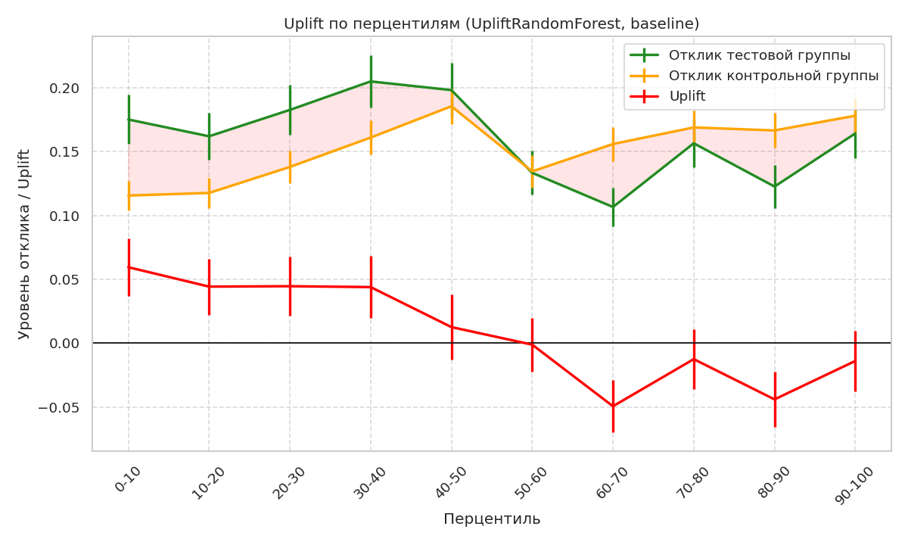
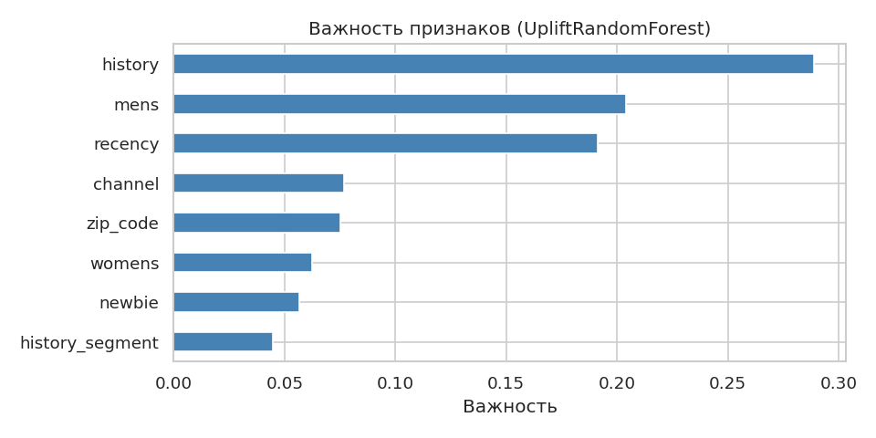
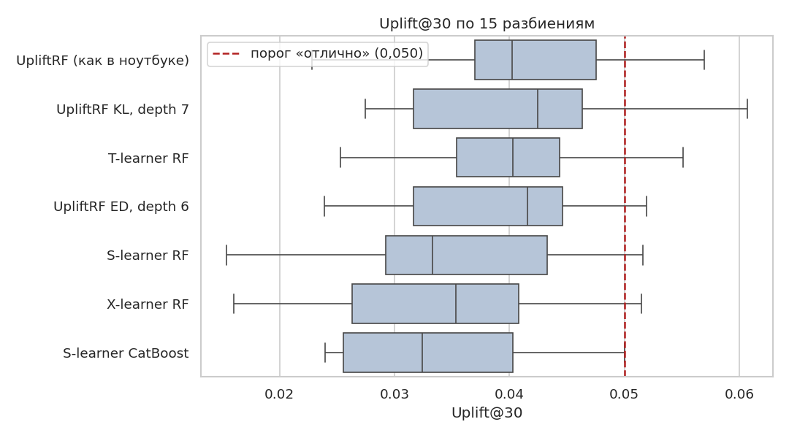

# Uplift-моделирование: кому предлагать промокод


Учебный проект курса повышения квалификации «Инженер машинного обучения» (Яндекс Практикум, финальный проект).

## Задача

Сервис доставки еды хочет выбрать аудиторию, которой стоит предложить промокод на 500 рублей: цель в том, чтобы пользователи заказывали чаще, а маркетинговый бюджет не тратился на тех, кто купил бы и без промокода. Для этого строится **uplift-модель**: она оценивает не вероятность отклика, а прирост вероятности отклика от самого предложения. Данные получены из A/B-теста.

## Данные

Файл `uplift_fp_data.csv`: 64 000 клиентов, совершивших покупку за последние 12 месяцев и участвовавших в тесте.

| Колонка | Описание |
|---|---|
| `recency` | месяцев с последней покупки |
| `history_segment` | категория расходов за год |
| `history` | сумма расходов за год, $ |
| `mens`, `womens` | покупал ли клиент мужские и женские товары (1/0) |
| `zip_code` | тип места проживания (город, пригород, село) |
| `newbie` | новый клиент (1/0) |
| `channel` | канал покупок (0 — мультиканал, 1 — мобильный, 2 — веб) |
| `treatment` | получил ли клиент промокод (1/0) |
| `target` | использовал ли промокод (1/0) |

Предобработка: пропусков нет; из набора удалены 7 015 полностью совпадающих строк (остаётся 56 985).

## Что сделано

**Часть 1. Методы uplift-моделирования**
- Первичная подготовка данных и EDA: баланс контрольной и тестовой групп, распределения признаков, корреляции.
- Проверка статистической значимости: χ²-тест для двух долей. Отклик в тестовой группе 16,02 % против 15,27 % в контрольной (+0,75 п.п., p = 0,0199).
- Три uplift-подхода из `causalml`: `UpliftRandomForestClassifier` (baseline), S-learner и T-learner на `RandomForestClassifier` с одинаковыми гиперпараметрами. Разбиение 80/20 со стратификацией по `treatment` и `target`, `random_state=42`. Важность признаков baseline-модели.

**Часть 2. Улучшение модели**
- Эксперименты с базовыми алгоритмами (логистическая регрессия, случайный лес, CatBoost) и новыми признаками (бины `history` по квантилям).
- Подбор гиперпараметров Optuna (метрика Uplift@30).
- Визуализации: кривые Uplift и Qini, uplift по перцентилям.
- Проверка устойчивости выбора модели кросс-валидацией (15 разбиений, семь подходов).
- Класс `UpliftModelInference` для передачи в продакшн: проверка входных данных, преобразование, предсказание uplift.

## Результаты

Метрики на отложенной выборке (20 %). Uplift@30 — метрика курса; Uplift AUC и Qini AUC оценивают ранжирование на всей аудитории и менее чувствительны к случайности:

| Модель | Uplift@30 | Uplift AUC | Qini AUC |
|---|---:|---:|---:|
| Uplift Random Forest (baseline) | 0,0494 | **0,0310** | **0,0659** |
| S-learner (RandomForest) | **0,0518** | 0,0296 | 0,0623 |
| T-learner (RandomForest) | 0,0449 | 0,0283 | 0,0595 |

S-learner показал лучший Uplift@30 (0,0518, выше порога 0,050), baseline UpliftRandomForest лучше по Uplift AUC и Qini AUC. Подбор гиперпараметров Optuna и замена базового алгоритма (логистическая регрессия, CatBoost) прироста не дали.

### Uplift по перцентилям

Клиенты разбиты на 10 групп по предсказанному uplift (baseline-модель). Эффект промокода положителен в верхних 40 % списка, около нуля в середине и отрицателен в нижних группах, поэтому промокод имеет смысл предлагать верхней части ранжированного списка.



### Важность признаков

Наибольший вклад в разбиения деревьев дают сумма трат за год (`history`), покупки мужских товаров (`mens`) и давность последней покупки (`recency`).



### Устойчивость выбора модели

Значение Uplift@30 на одном разбиении сильно зависит от случайности, поэтому семь подходов сравнены на 15 разбиениях (5 блоков × 3 повтора со стратификацией по `treatment` и `target`):

| Модель | Uplift@30, среднее ± std | Qini AUC |
|---|---:|---:|
| **UpliftRF (параметры baseline)** | **0,0415 ± 0,0088** | 0,0499 |
| UpliftRF, критерий KL, глубина 7 | 0,0406 ± 0,0099 | 0,0471 |
| T-learner RF | 0,0402 ± 0,0083 | 0,0452 |
| UpliftRF, критерий ED, глубина 6 | 0,0386 ± 0,0087 | 0,0514 |
| S-learner RF | 0,0352 ± 0,0105 | 0,0439 |
| X-learner RF (propensity score) | 0,0340 ± 0,0103 | 0,0442 |
| S-learner CatBoost | 0,0340 ± 0,0091 | 0,0504 |



По среднему качеству и по Qini AUC лучше выглядит uplift-лес, поэтому для внедрения рекомендуется `UpliftRandomForestClassifier`; S-learner остаётся моделью с лучшим Uplift@30 на отложенной выборке курса. Код эксперимента и результаты: папка `experiments/`.

Подробности, остальные графики и выводы: ноутбук `final_project_template.ipynb`.

## Структура репозитория

```text
.
├── final_project_template.ipynb   # EDA, модели, подбор гиперпараметров, кросс-валидация, класс для инференса
├── utils.py                       # график uplift по перцентилям
├── uplift_fp_data.csv             # данные A/B-теста
├── requirements.txt
├── experiments/                   # кросс-валидация подходов: скрипт, результаты, Dockerfile
├── figures/                       # графики для README
├── scikit_uplift/                 # модифицированная библиотека scikit-uplift (клонируется отдельно)
└── README.md
```

## Установка и запуск

Рекомендуется Python 3.10.13: с другими версиями возможны конфликты библиотек.

```bash
git clone <ссылка-на-репозиторий>
cd <папка-проекта>
python3 -m venv uplift_env
source uplift_env/bin/activate
pip install -r requirements.txt
```

Библиотека `scikit-uplift` в версии курса подключается как папка `scikit_uplift` в корне репозитория (ноутбук и `utils.py` импортируют `scikit_uplift.metrics.metrics`):

```bash
git clone https://github.com/yandex-praktikum/mle-scikit-uplift-2025 scikit_uplift
```

Затем откройте ноутбук `final_project_template.ipynb` и выполните ячейки последовательно:

```bash
jupyter lab
```

Окружение можно также собрать в Docker, см. `experiments/README.md`.
